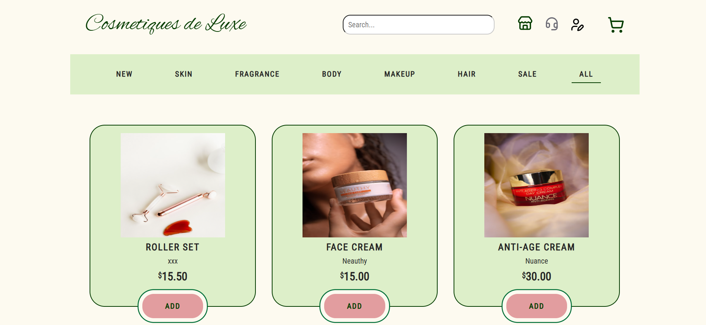
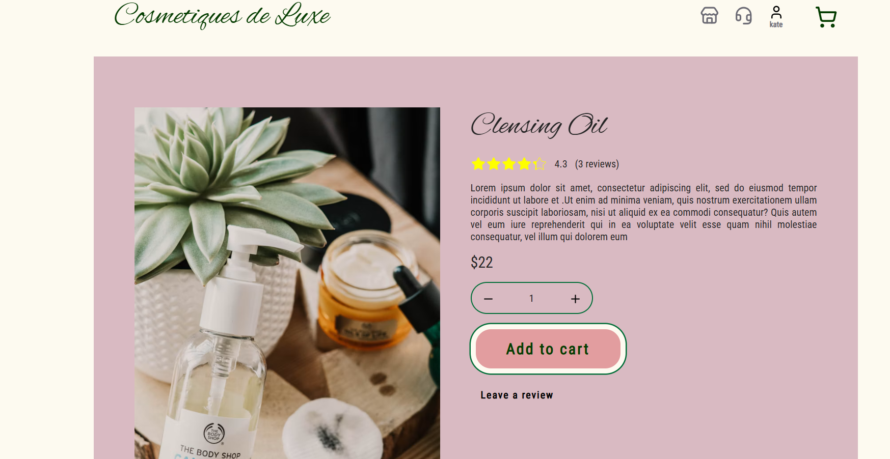
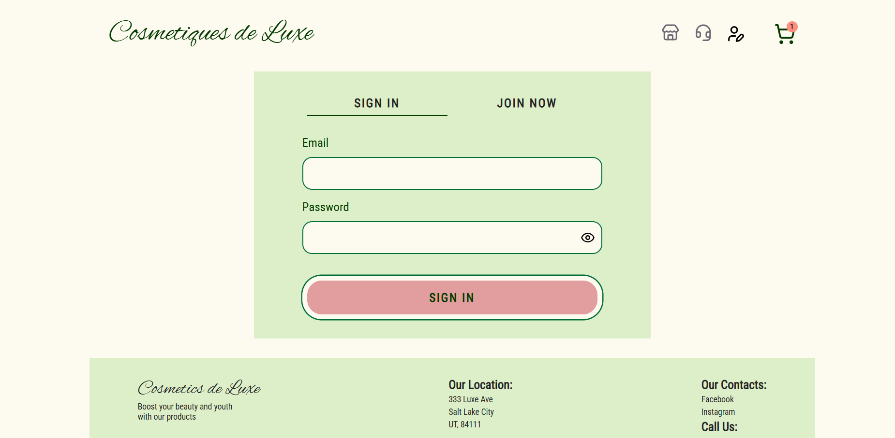
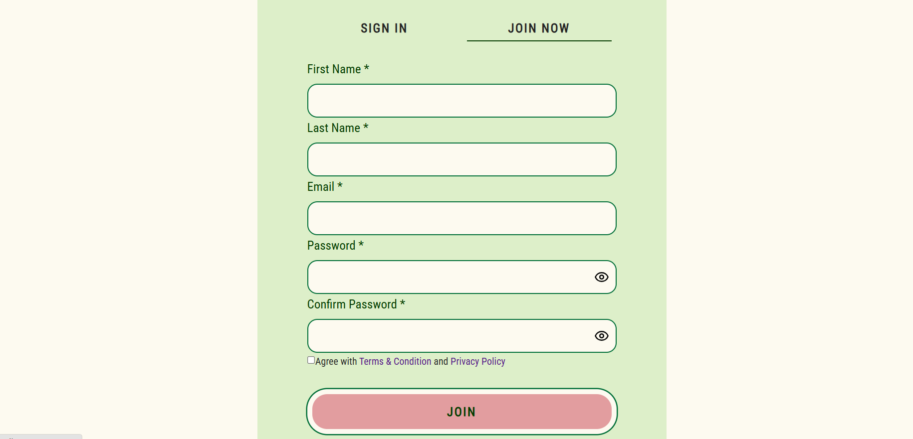
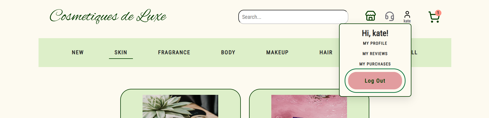
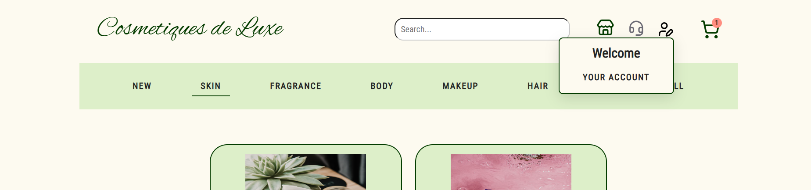

# Beauty Store — E-Commerce Web Application

A full-stack e-commerce application built using the MERN stack (MongoDB, Express.js, React, and Node.js).

The project includes product browsing, shopping cart functionality, user authentication, customer reviews, and account management features.

The application is designed with reusable React components, responsive layouts, and REST API integration.
## Live Demo

- **Live Application:** [Beauty Store](https://kate-beauty-store.netlify.app/)
- **Frontend Repository:** [GitHub](https://github.com/khryaznykh/beauty-store-frontend)
- **Backend Repository:** [GitHub](https://github.com/khryaznykh/beauty-store-backend)

The application is deployed using Netlify for the frontend, Render for the backend API, and MongoDB Atlas for database hosting.

**Note:** The backend is hosted on Render's free tier, so the first API request may take additional time if the service has been inactive.

## Tech Stack

### Frontend
- React
- JavaScript (ES6+)
- Vite
- React Router
- Redux Toolkit and RTK Query
- React Context API
- React Hook Form
- SCSS Modules
- Lucide React
- Swiper.js

### Backend
- Node.js
- Express.js
- MongoDB Atlas
- Mongoose
- JSON Web Tokens (JWT)
- bcrypt for password hashing
- REST API

### Deployment
- Netlify — frontend
- Render — backend
- MongoDB Atlas — database

## Authentication and Authorization

Authentication is implemented using **JWT-based authentication**, React Context API, and browser cookies.

### How authentication works

1. Users sign in using their email and password.
2. The backend verifies their credentials and returns a JWT access token.
3. The frontend stores the token in a cookie using `js-cookie`.
4. React Context manages the authentication state through a custom `AuthProvider` and `useAuth()` hook.
5. The `jwt-decode` library checks the token's expiration time on the frontend.
6. RTK Query automatically attaches the JWT to authenticated API requests using the `Authorization: Bearer <token>` header.
7. Express authentication middleware verifies the JWT signature and expiration before allowing access to protected endpoints.
8. Users are logged out when the token expires or the backend rejects an authenticated session.

### Authentication features
- User registration and sign-in
- JWT access-token authentication
- Password hashing with bcrypt
- Persistent login state across page refreshes while the token remains valid
- Automatic logout on JWT expiration
- Protected backend API endpoints
- Authentication-aware navigation
- Account dropdown with different options for guests and authenticated users

**Security note:** The current implementation stores the JWT in a JavaScript-accessible cookie. A future improvement is migrating to backend-managed HttpOnly cookies.

## Frontend Architecture & State Management

The frontend uses a modular, feature-oriented architecture to separate application configuration, business features, reusable components, and page-level functionality.

### State Management

- **Redux Toolkit & RTK Query** — Manage API communication, asynchronous requests, server-state caching, and data invalidation.
- **React Context API** — Manages global authentication state through a custom `AuthProvider` and `useAuth()` hook.
- **React Hook Form** — Handles form state, input validation, and submission.
- **React local state** — Manages component-specific interactions and UI behavior.

### Component Architecture

The application uses reusable UI components such as buttons, inputs, layout containers, navigation elements, and product-related components.

SCSS Modules provide component-scoped styling, helping keep styles organized and reducing unintended CSS conflicts.

### Routing

React Router manages navigation between application pages. The UI adapts based on authentication status, displaying different account navigation options for guests and signed-in users.

## Screenshots

### Homepage


### Shopping Page


### Product Details


### Authentication



### Account Dropdown



## Features

### Implemented

**Product Browsing**
- Product catalog and individual product detail pages
- Reusable product-related UI components
- Backend API integration for product data

**Shopping Cart**
- Shopping cart interface and functionality
- Cart navigation and cart status display

**Authentication**
- User registration and sign-in forms
- JWT-based authentication integration
- Authentication state managed through React Context
- Automatic logout based on token expiration
- Conditional account navigation for authenticated and unauthenticated users
- Account dropdown menu

**Forms & Validation**
- Form management using React Hook Form
- Client-side input validation
- API error handling and user feedback

**Application Architecture**
- Client-side routing using React Router
- Server-state management and caching with RTK Query
- Reusable components and SCSS Modules
- Modular, feature-oriented project organization

### In Progress / Requires Further Testing

- Customer review submission, editing, and deletion
- Complete user profile interface
- Mobile-friendly account dropdown behavior
- Improved authentication error handling
- Clearing authenticated user data from RTK Query cache on logout
- Additional responsive design and accessibility improvements
  
## Project Structure

The frontend follows a modular, feature-oriented structure.

Key areas include:

- `app/` — application setup, routing, and providers
- `features/` — authentication and other feature-specific logic
- `widgets/` — larger reusable page sections
- `shared/` — reusable UI components, utilities, and authentication context
- `pages/` — application pages

## Running Locally

### Prerequisites
- Node.js
- npm
- A running backend API

### Installation

Clone the frontend repository:

```bash
git clone https://github.com/khryaznykh/beauty-store-frontend.git
cd beauty-store-frontend
```

Install dependencies:

```bash
npm install
```

Create a `.env` file in the project root:

```env
VITE_API_URL=http://localhost:8000
```

Start the development server:

```bash
npm run dev
```

The frontend will connect to the configured backend API.

## Planned Features / Roadmap

Beauty Store is actively being developed. Planned improvements include:

- **Admin Dashboard** — Frontend interfaces for managing products, users, customer reviews, and orders.
- **Stripe Checkout Integration** — Secure checkout UI integrated with backend payment processing.
- **Enhanced User Profiles** — Profile editing, account settings, and purchase history.
- **Order Management** — Order history, tracking, and status information.
- **Authentication Improvements** — More secure session handling and token storage.
- **Testing** — Unit and integration tests for components and application functionality.
- **UI/UX Improvements** — Accessibility, responsive design, and mobile navigation enhancements.

## Project Status

**Active Development**

The application currently includes product browsing, shopping cart functionality, authentication, and reusable frontend components.

Administrative interfaces, Stripe checkout, and expanded account management features are planned for future development.

This project demonstrates practical experience with React, JavaScript, frontend architecture, REST API integration, authentication, form handling, and state management.
